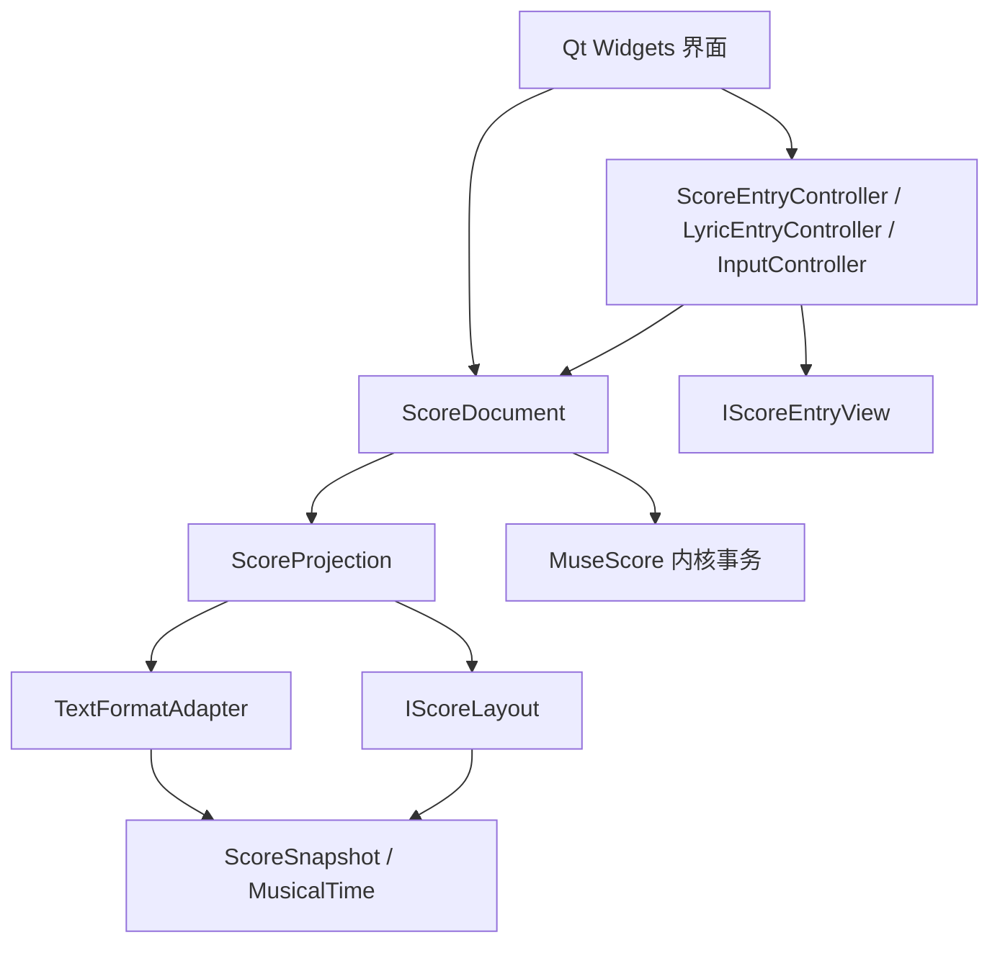

# 模块与扩展约定

音乐数据只由 `ScoreDocument` 所持的 MuseScore `MasterScore` 修改。文字稿、布局和选择都不能创建第二份可编辑音乐模型。`ScoreSnapshot` 是值类型快照；图元与命中区域由同一份排版结果产生。

## 依赖方向

CMake 将纯文字语法编为 `jianpu_notation`（Qt Core），排版与投影编为 `jianpu_presentation`（Qt Gui），内核和文档编为 `jianpu_document`，窗口与交互编为 `jianpu_editor`。文字语法和排版模块不能引用窗口或 MuseScore DOM。依赖单向链接，不通过窗口调用另一模块的内部状态。

## 同步事务

`TextFormatAdapter` 负责解析、序列化与曲行回写；首个实现是 `FanqieFormat`。`IScoreLayout` 只读取快照与设置，输出页面、系统时间范围、图元和命中区域。`ScoreProjection` 组合这两个接口，可在构造时注入替代实现。

文字修改先保留精确的 `SourceChanges`，在临时内核工程中构建音乐并校验，成功后替换文档；谱面修改通过内核事务提交。文档随后按同一排版结果同步自动小节线、Q/C 曲行、稳定音符标识与歌词绑定，迭代至换行稳定。回写属于原操作的历史记录。`ScoreCanvas` 直接消费文档的 `presentation()`，不再另算一次布局。排版设置改变也走同一路径。

诊断区分语法、未闭合结构、超出歌词和删除音符留下的歌词。超出歌词不能阻止其他曲行补齐小节线和分页。超出词位附在原曲行的最后一个分行上；删除音符的歌词进入独立待分配区。重复 `C1` 按曲行中的出现顺序标明歌词段次，声部编号含义不变。

文字工程中的无输入尾部是内核补齐的空白，不生成多余的可视化声部行。原生导入乐谱仍保留完整的休止与谱表。当前文字语法不能完整表示的原生导入内容受保护，仍通过内核事务编辑；不能用不完整的文字重建覆盖它。

## 输入职责

`EntrySession` 保存当前输入表面和追加／修改／插入状态。`ScoreEntryController` 负责音符输入、后缀、前进位置及退格；通过 `IScoreEntryView` 查询只读乐谱与选择，不依赖 `ScoreCanvas` 或窗口类。`MusicTextEditing` 集中执行带精确范围的文字插入与音乐单位删除，禁止在事件过滤器中重复实现 Q 行修改。

`LyricEntryController` 负责主音符词位、歌词插入／覆盖／删除、选区替换与新段创建；输入法预编辑仅在画布预览，提交后调用 `ScoreDocument::setLyrics()` 批量事务。歌词选择使用 `LyricSlot`，不会被当作可偏移图形。`LyricSourceMap` 是 Qt Core 的纯文字位置映射，负责 C 行与精确音乐时间的关联，窗口不再自行猜测歌词范围。

`InputController` 只负责文字编辑器、输入法提交、焦点、源文光标和 B/Z/D/P/Q/C 命令对话框。窗口只提供工具栏和信号连接。鼠标选择或方向键导航决定默认模式；控制器内部输入后的选择更新保留用户选择的插入模式。末尾空白是交互覆盖层，不属于音乐图元，不进入纯谱面导出。

新增输入方法应向文档提交同样的 `EditRequest` 或带 `SourceChanges` 的文字事务，不在控件中维护音符数组。增加新文字格式时实现 `TextFormatAdapter` 并扩展工厂；新增排版实现 `IScoreLayout`。

## 可调整元素

`VisualElement` 是非音符交互的公共基类，保存语义身份、持久键、内核关联和所属图元。`TextVisualElement` 使用实际字体墨迹计算命中，`SymbolVisualElement` 使用路径描边；组合元素共用一个身份并整组移动。

`VisualElementRegistry` 将布局图元绑定到元素。新增元素类型可派生 `VisualElement`、实现 `hitShape()` 并在注册阶段创建它。所有绘制图元必须归属元素；音符本体的音乐位置仍由时间轴决定。不要在窗口中按某个标题文字或图元下标保存位置。

音符和歌词不参与图形偏移。文档的 `moveElement()` 保存相对于自动布局锚点的偏移，`transformElement()` 保存旋转角度和等比缩放，位于 `view.json/elementOffsets`，通过统一历史支持撤销。标题／页眉使用稳定语义键，记号优先关联稳定逻辑音符。统一的图元变换同时用于绘制、裁剪与命中，不单独修改点击区域。`AlignmentSnapper` 只负责边缘／中心线的几何吸附，交互层在拖动预览后一次提交。图形移动不改变音高、时值或文字稿内容。`MarkPlacement` 单独负责记号垂直层和当前系统内的空间预留，不使用跨系统的全局水平推挤。

## 选择与内容片段

`SelectionPolicy` 是无窗口依赖的范围规则，输入元素身份、选择组、精确时间及矩形，输出选择标识。音符按声部成组，歌词按声部与段次成组，小节选择则覆盖所有声部。`MeasureRegion` 与 `LyricSlot` 由排版生成，交互层消费同一份结果，不依赖绘图像素猜测小节边界。`scorecanvas_selection.cpp` 单独处理划选、拖动状态、剪贴板与落点；图形变换和音乐内容搬移互不混用。

文档公开值类型 `ScoreSelection`、`ScoreDropTarget` 和 `copyFragment/pasteFragment/deleteFragment` 接口，不接收控件或鼠标事件。片段封装版本、精确长度、内核 StaffList 数据及源元素标识。连续完整音符作为一个区间复制，保留连音组、连奏线和歌词；非连续区间按顺序组装，和弦单音只复制选中的音高。整节则记录全部谱表和反复等小节属性。

批量操作通过统一 `cloneProject()` 创建完整内核副本，在副本中调用原生节奏及粘贴事务并做节奏检查，全部成功后才替换主文档，整次操作共用一次应用历史。歌词片段同样调用批量歌词事务。复制源的原生乐器定义或扩展对象不因投影看似简单而变成可重建文字；`textOrigin` 明确区分应用文字工程与原生导入。`FanqieFormat::replaceMusic()` 保留文字工程的头部、注释与未知字段，文档随后重新生成绑定并按排版回写 Q/C 曲行。

删除内容留下的歌词进入待分配区；临时草稿未提交时批量操作失败而不覆盖草稿。真实格式错误与待分配歌词是导出的条件，历史 `hasErrors` 标记不能单独阻挡有效曲谱。

## 验证入口

`tst_selection` 验证范围选择、批量片段、失败回滚和精确落点；`tst_lyrics` 验证谱面词位编辑、原生保护与图形变换；`tst_projection` 验证上述模块合作的用户行为；原有格式、工程、编辑和布局套件继续验证各自边界。界面行为使用真实文档和控件驱动，核心布局可直接用快照与固定字体验证几何。Linux 验证不能替代 Windows 字体、输入法和部署验收。
